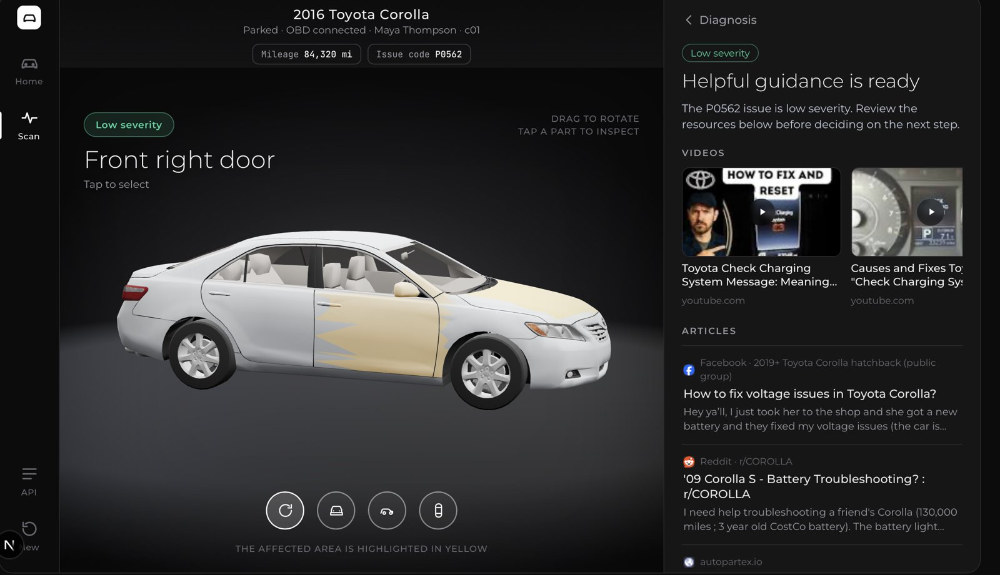
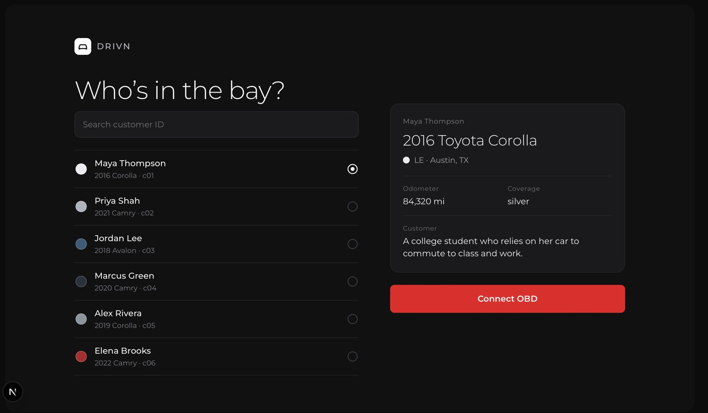
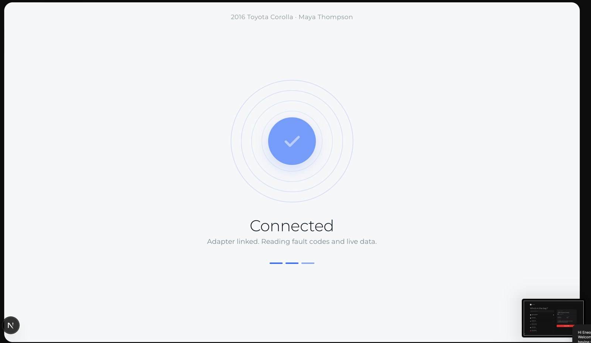

# Drivn

**From check-engine light to the right repair bay, in one screen.**

Built by **Team Navonic** (Navigation + Electronics) for HackTX.

Drivn plugs into a car's OBD-II port, reads what's wrong, and tells the driver three things they usually have to piece together from a mechanic, an insurer and a search engine: **how serious it is, what it will cost them, and where to go.** The whole experience is centred on an interactive 3D model of the customer's own car, with the affected part highlighted in yellow.


<p align="center">
  
</p>
<p align="center">
  
  
</p>

---

## What it does

1. **Pick the customer.** A technician or driver selects a profile (vehicle, mileage, insurance level, location).
2. **Connect to the car.** The app pairs with an OBD-II adapter and reads the fault code, vehicle model and mileage.
3. **Diagnose.** The backend combines the OBD reading, the technician's findings, the customer profile and their insurance policy, and decides how severe the issue is.
4. **Branch on severity.**
   - **Low severity** (a weak battery, an oil change, a cosmetic scratch): Drivn finds repair guides and videos for that exact car and fault code, so the driver can fix it or book it without panic.
   - **High severity** (an airbag fault, a transmission failure, a brake hydraulic leak): an AI agent reads the insurance policy and returns whether the car is safe to drive, whether the repair is covered, the estimated repair cost, the deductible, what insurance pays and what the driver pays, plus clear next steps.
5. **File the claim.** For serious issues, Drivn autofills an insurance claim from everything it already knows: customer, vehicle, fault code, affected part, diagnosis and costs. The driver reviews it and files it in one tap (a demo filing for now).
6. **Get there.** Once the claim is filed, Drivn finds nearby Toyota service centres around the driver's location, with distance, phone and directions.

The 3D car stays live the whole time. It loads in parallel with the diagnosis, so the driver is never staring at a spinner, and they can rotate it and tap any part to see what's wrong with it.

## Why it matters

A warning light is one of the most stressful moments in car ownership because it arrives with **no context**. The driver doesn't know if it's a $20 fix or a $4,000 one, if the car is safe to drive home, or if insurance will help. Today the answers come from three places that don't talk to each other.

- **Safety first.** For serious faults, the first thing Drivn shows is whether the car is safe to drive, before any cost or paperwork.
- **Money clarity before the repair, not after.** Coverage, deductible, insurer payment and out-of-pocket cost are shown up front, calculated against the customer's actual policy. That removes the surprise bill and the "is this covered?" phone call.
- **Less friction to a claim.** Claims are tedious, so people delay them or never file. Autofilling from diagnostic data turns a 30-minute form into a review.
- **Right-sized responses.** Not every light needs a dealer visit. Routing minor issues to trusted guides saves drivers money and frees up service bays for the cars that really need them.
- **Accessible to non-experts.** A 3D car with the problem highlighted explains "front crash sensor bracket displaced" better than a fault code ever will.

For dealers and insurers, the same flow means better-prepared customers, cleaner claim data at the first touchpoint, and service bays booked with the right work.

## Tech stack

| Layer | Tools |
|---|---|
| **Frontend** | Next.js 15 (App Router), React 19, TypeScript |
| **3D** | Three.js, React Three Fiber, Drei (glTF model loading, studio lighting, orbit controls, per-part highlighting) |
| **Backend** | Python, FastAPI, Pydantic, httpx |
| **AI agent** | Snowflake Cortex Agent: analyses high-severity cases against the insurance policy and returns safety, coverage, cost breakdown and recommendations |
| **Search** | SerpAPI: repair articles and videos for low-severity issues, and replacement-part listings |
| **Locations** | OpenStreetMap Nominatim: geocodes the customer's city and finds nearby Toyota service centres |
| **Vehicle hardware** | OBD-II via an ELM327 adapter (an ELM327 emulator and Arduino Uno scripts are in `arduino/` for testing without a car) |
| **Data** | Mock customer profiles, technician diagnoses and an insurance policy document in `data/` |

## Project structure

```
HackTX-Project/
  agent-backend/         FastAPI service: customers, diagnostic sessions, service locations
  data/                  mock customers, insurance policy
  frontend/
    diagnostic-bay/      the Drivn web app (Next.js + Three.js)
  arduino/               OBD-II / ELM327 experiments and emulator
  API_CONTRACT.md        request and response shapes between frontend and backend
```

## Running it

**Backend** (needs a `.env` with your SerpAPI key and Snowflake credentials; see `.env.example`):

```bash
cd agent-backend
uvicorn main:app --reload --port 8000
```

**Frontend:**

```bash
cd frontend/diagnostic-bay
npm install
npm run dev
```

Open http://localhost:3000. More detail is in `frontend/diagnostic-bay/README.md`.

### API at a glance

| Route | Purpose |
|---|---|
| `GET /customers/{id}` | Customer profile: vehicle, mileage, insurance level, location |
| `POST /diagnostic-sessions` | Runs the diagnosis; returns resources (low) or the agent's safety, coverage and cost analysis (high) |
| `GET /3d-visualization/{id}` | Vehicle model information for the 3D view |
| `GET /service-locations?location=` | Nearby Toyota service centres |
| `GET /health` | Health check |

## What's next

**Near term**
- **A real model for every vehicle.** Return per-model 3D assets from `/3d-visualization` with parts already named, so highlighting maps exactly to the panel or component that failed.
- **Booking, not just directions.** Show live service availability and book the appointment from the same screen, passing the diagnosis to the service centre ahead of time.
- **Photo capture for claims.** Let the driver add damage photos to the autofilled claim.


---
**Team Navonic**: Navigation + Electronics.

**Members**
- Eneojo (Joe)
- Matthew
- Advaith
- Pranit
